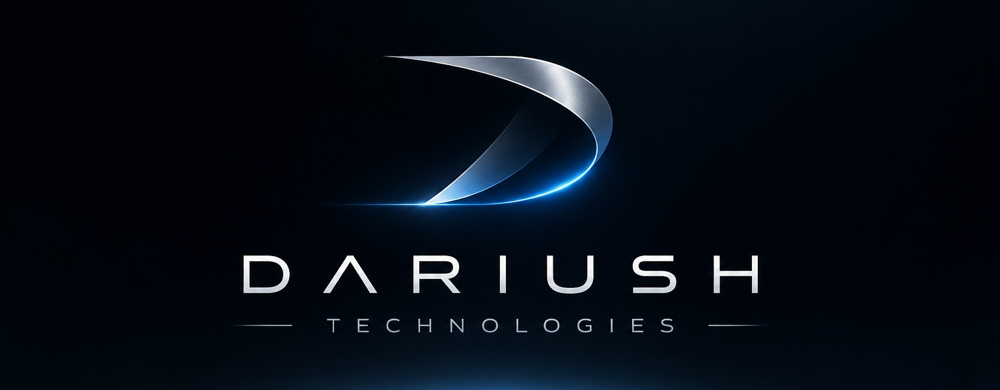

<p align="center">
  
</p>

<h3 align="center">Software engineering for business web apps, AI automation and interactive web.</h3>

<p align="center">
  <a href="https://dariush-tech.github.io/hesabyar-showcase/"></a>
  <a href="https://dariush-tech.github.io/anfas-interiors/"></a>
  <a href="https://dariush-tech.github.io/anfas-villa/"></a>
  <a href="#client-demos"></a>
</p>

---

### About

Dariush Technology builds software that does real work for real businesses: Persian, right-to-left business apps
(accounting, CRM panels, catalogs, booking and request flows), fast interactive websites, and AI pipelines that automate
content and operations. Small, dependency-light code that ships and is tested on phones and desktops.

```js
const dariushTechnology = {
  studio:   "DARIUSH Digital Studio",
  focus:    ["Business web apps (Persian RTL)", "AI & automation", "Web experiences", "Browser tools"],
  stack:    ["TypeScript", "JavaScript", "Python", "NestJS", "Next.js", "PostgreSQL", "WebGL"],
  tooling:  ["Playwright", "OpenCV", "FFmpeg", "Git", "GitHub Pages"],
  approach: "Ship small, measure, iterate.",
};
```

### What I build

| | |
|---|---|
| 📊 **Business software** | Accounting and ERP, CRM and request panels, catalogs and order flows, Jalali dates, Persian RTL, phone first |
| 🤖 **AI & automation** | LLM tool integrations (MCP), assistants that act only after confirmation, AI image and video pipelines |
| 🌐 **Web experiences** | Scroll-driven storytelling sites, WebGL effects, calculators and configurators |
| 🧩 **Browser tools** | Chrome extensions, Playwright automation, internal developer tools |

### Featured projects

<table>
  <tr>
    <td colspan="2" valign="top">
      <a href="https://github.com/dariush-tech/hesabyar-showcase"></a>
      <h4><a href="https://github.com/dariush-tech/hesabyar-showcase">Hesabyar · حسابیار</a></h4>
      A Persian accounting and business-management web app: double-entry ledger, sales and inventory, point of sale, payroll,
      production, contracting and a Persian AI assistant that drafts invoices and acts only after the user confirms.
      <br><br>
      <code>NestJS</code> <code>Next.js</code> <code>PostgreSQL</code> <code>TypeScript</code> <code>RTL · Jalali</code>
      <br><br>
      <a href="https://dariush-tech.github.io/hesabyar-showcase/"><b>Live preview</b></a> · <a href="https://github.com/dariush-tech/hesabyar-showcase">Showcase</a> · source is private
    </td>
  </tr>
  <tr>
    <td width="50%" valign="top">
      <a href="https://github.com/dariush-tech/anfas-interiors"></a>
      <h4><a href="https://github.com/dariush-tech/anfas-interiors">ANFAS Interiors</a></h4>
      One room taken apart and rebuilt by scroll, with a WebGL depth reveal, a material studio, a before/after slider and a fit-out estimator.
      <br><br>
      <code>WebGL</code> <code>GLSL</code> <code>Vanilla JS</code> <code>CSS</code>
      <br><br>
      <a href="https://dariush-tech.github.io/anfas-interiors/"><b>Live demo</b></a> · <a href="https://github.com/dariush-tech/anfas-interiors">Code</a>
    </td>
    <td width="50%" valign="top">
      <a href="https://github.com/dariush-tech/anfas-villa"></a>
      <h4><a href="https://github.com/dariush-tech/anfas-villa">ANFAS Villa</a></h4>
      A cinematic scroll story that builds a Dubai villa from the first line to handover, with a finish studio and a project estimator.
      <br><br>
      <code>Scroll animation</code> <code>Vanilla JS</code> <code>CSS</code> <code>OpenCV</code>
      <br><br>
      <a href="https://dariush-tech.github.io/anfas-villa/"><b>Live demo</b></a> · <a href="https://github.com/dariush-tech/anfas-villa">Code</a>
    </td>
  </tr>
</table>

<h3 id="client-demos">Client demos</h3>

Proposal demos made by DARIUSH Digital Studio for Iranian businesses. Each one is a Persian, right-to-left, phone-first web app
that runs as a static page on GitHub Pages, with sample data kept in the visitor's browser and no real messages, payments or uploads.

<table>
  <tr>
    <td width="50%" valign="top">
      <a href="https://github.com/dariush-tech/madar-sewing-checklist"></a>
      <h4><a href="https://github.com/dariush-tech/madar-sewing-checklist">First garment sewing checklist</a></h4>
      Pick a first garment, mark each skill as not yet, practising or mastered, and see progress, the next step and a summary to copy for the teacher.
      <br><br>
      <a href="https://dariush-tech.github.io/madar-sewing-checklist/"><b>Live demo</b></a> · <a href="https://github.com/dariush-tech/madar-sewing-checklist">Code</a>
    </td>
    <td width="50%" valign="top">
      <a href="https://github.com/dariush-tech/cafeprint-mockup-demo"></a>
      <h4><a href="https://github.com/dariush-tech/cafeprint-mockup-demo">Large-format print mockup</a></h4>
      Enter the installation size, viewing distance and site, see the design on the site photo at real scale with a readability check, and prepare a test inquiry.
      <br><br>
      <a href="https://dariush-tech.github.io/cafeprint-mockup-demo/"><b>Live demo</b></a> · <a href="https://github.com/dariush-tech/cafeprint-mockup-demo">Code</a>
    </td>
  </tr>
  <tr>
    <td width="50%" valign="top">
      <a href="https://github.com/dariush-tech/soroush-javid-course-compare"></a>
      <h4><a href="https://github.com/dariush-tech/soroush-javid-course-compare">Vocational course comparison</a></h4>
      Pick a goal and experience level, see suggested courses with a reason, compare two side by side and copy a summary for the counselor.
      <br><br>
      <a href="https://dariush-tech.github.io/soroush-javid-course-compare/"><b>Live demo</b></a> · <a href="https://github.com/dariush-tech/soroush-javid-course-compare">Code</a>
    </td>
    <td width="50%" valign="top">
      <a href="https://github.com/dariush-tech/server-center-config-demo"></a>
      <h4><a href="https://github.com/dariush-tech/server-center-config-demo">HPE ProLiant RAM &amp; disk configurator</a></h4>
      Pick a server and use case, choose RAM and disks with live totals and three-state compatibility, fix what doesn't fit and prepare an inquiry sheet.
      <br><br>
      <a href="https://dariush-tech.github.io/server-center-config-demo/"><b>Live demo</b></a> · <a href="https://github.com/dariush-tech/server-center-config-demo">Code</a>
    </td>
  </tr>
  <tr>
    <td width="50%" valign="top">
      <a href="https://github.com/dariush-tech/renovation-clinic-demo"></a>
      <h4><a href="https://github.com/dariush-tech/renovation-clinic-demo">Renovation consultation requests</a></h4>
      Short request form with sample photos and a tracking code, plus a consultant panel with search, filters, a pre-call brief, notes and statuses.
      <br><br>
      <a href="https://dariush-tech.github.io/renovation-clinic-demo/"><b>Live demo</b></a> · <a href="https://github.com/dariush-tech/renovation-clinic-demo">Code</a>
    </td>
    <td width="50%" valign="top">
      <a href="https://github.com/dariush-tech/pooya-andish-path-demo"></a>
      <h4><a href="https://github.com/dariush-tech/pooya-andish-path-demo">Art school learning path</a></h4>
      Pick the artwork you want to make, answer two questions and get a three-stage course path with a summary to copy for a consultation.
      <br><br>
      <a href="https://dariush-tech.github.io/pooya-andish-path-demo/"><b>Live demo</b></a> · <a href="https://github.com/dariush-tech/pooya-andish-path-demo">Code</a>
    </td>
  </tr>
  <tr>
    <td width="50%" valign="top">
      <a href="https://github.com/dariush-tech/raily-wholesale-catalog-demo"></a>
      <h4><a href="https://github.com/dariush-tech/raily-wholesale-catalog-demo">Wholesale clothing catalog</a></h4>
      Phone-first catalog with an editable order, minimum-order checks, a structured summary to copy and a WhatsApp preview.
      <br><br>
      <a href="https://dariush-tech.github.io/raily-wholesale-catalog-demo/"><b>Live demo</b></a> · <a href="https://github.com/dariush-tech/raily-wholesale-catalog-demo">Code</a>
    </td>
    <td width="50%" valign="top">
      <a href="https://github.com/dariush-tech/helger-consult-demo"></a>
      <h4><a href="https://github.com/dariush-tech/helger-consult-demo">Interior design consultation</a></h4>
      Two-step consultation form with a sample photo gallery and a summary before submitting, plus an inbox of incoming projects.
      <br><br>
      <a href="https://dariush-tech.github.io/helger-consult-demo/"><b>Live demo</b></a> · <a href="https://github.com/dariush-tech/helger-consult-demo">Code</a>
    </td>
  </tr>
  <tr>
    <td width="50%" valign="top">
      <a href="https://github.com/dariush-tech/mft-course-applicants-demo"></a>
      <h4><a href="https://github.com/dariush-tech/mft-course-applicants-demo">Course applicant tracking</a></h4>
      Consultation requests for courses and an enrollment panel with filters, notes, follow-up stages and reminder previews.
      <br><br>
      <a href="https://dariush-tech.github.io/mft-course-applicants-demo/"><b>Live demo</b></a> · <a href="https://github.com/dariush-tech/mft-course-applicants-demo">Code</a>
    </td>
    <td width="50%" valign="top">
      <a href="https://github.com/dariush-tech/anil-appointment-demo"></a>
      <h4><a href="https://github.com/dariush-tech/anil-appointment-demo">Clinic appointment follow-up</a></h4>
      Patients confirm or reschedule an appointment; reception approves changes and previews the reminder message.
      <br><br>
      <a href="https://dariush-tech.github.io/anil-appointment-demo/"><b>Live demo</b></a> · <a href="https://github.com/dariush-tech/anil-appointment-demo">Code</a>
    </td>
  </tr>
  <tr>
    <td width="50%" valign="top">
      <a href="https://github.com/dariush-tech/abfam-inquiry-demo"></a>
      <h4><a href="https://github.com/dariush-tech/abfam-inquiry-demo">Industrial equipment inquiries</a></h4>
      Customers register an equipment inquiry and get a tracking code; the sales panel searches, opens and moves each inquiry through its statuses.
      <br><br>
      <a href="https://dariush-tech.github.io/abfam-inquiry-demo/"><b>Live demo</b></a> · <a href="https://github.com/dariush-tech/abfam-inquiry-demo">Code</a>
    </td>
    <td width="50%" valign="top">
      <h4>How the demos are built</h4>
      <ul>
        <li>Static files on GitHub Pages: no build step, server, account or API key</li>
        <li>Persian RTL and phone first, with editable rules and sample content</li>
        <li>Sample data kept in the visitor's browser with <code>localStorage</code></li>
        <li>Copy-ready Persian summaries where a flow ends in a message</li>
        <li>Light and dark themes, tested end to end on phone and desktop</li>
      </ul>
    </td>
  </tr>
</table>

### Tech stack

<p>
  
  
  
  
  
  
  
</p>
<p>
  
  
  
  
  
  
  
</p>
<p>
  
  
  
</p>

### Working together

Open to freelance projects and collaborations: business web apps, websites, AI automation and custom tools.
Each client demo above is a working proposal, so a business can try the idea instead of reading about it.
